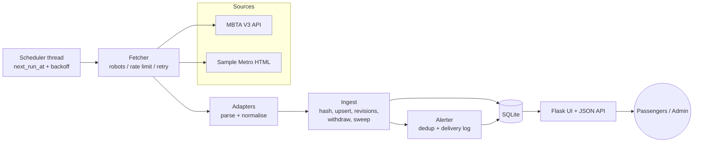
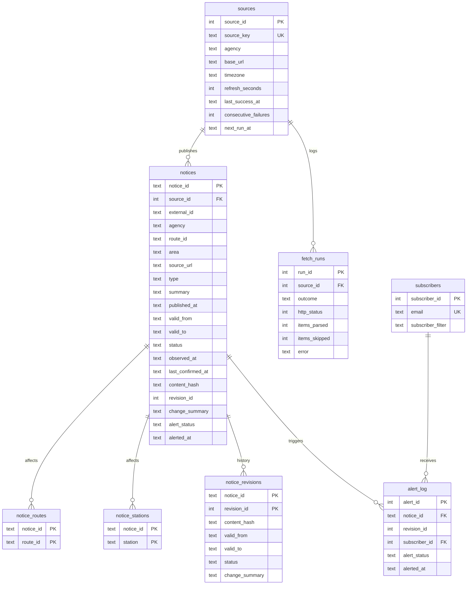

# TransitNotice — Public Transport Service Update Tracker

**Project code:** WEB-07 (Web Scraping, SRS 2026)
**Student / team IDs:** ______________________
**Mentor:** ______________________
**Academic year:** 2026–27
**Institution / programme:** Cybernaut EdTech, Endeavour to Explore

---

## 1. Abstract and context

Passengers lose time and miss connections when they do not hear about diversions, suspensions and planned closures. Agencies do publish official advisories, but they are spread across pages and feeds, often lack a clear validity window, and are silently edited or removed. TransitNotice collects official advisories on a schedule. It normalises them into a single model (route, station, area, type and validity window) and tracks every revision. It publishes a searchable dashboard where every notice shows **when it was last verified and which official page it came from**.

### User personas

TransitNotice is focused on **Tamil Nadu**. Its live source is Chennai Metro Rail Limited's (CMRL) official traffic-diversion notices for the Phase 2 metro construction corridors.

| Persona | Needs | How TransitNotice helps |
|---|---|---|
| **Priya, daily commuter in Chennai** (drives/takes the bus along Corridor 4, Poonamallee - Porur) | Know whether her road is diverted by metro works before leaving home | Choose "Corridor 4" or her location from a drop-down, plus one email when a diversion on her corridor is new or revised |
| **Ravi, MTC bus / auto driver** | Which junctions are closed and the alternative route | Location drop-down (e.g. "Kodambakkam"), with the official diversion text and a link to the CMRL map page |
| **Meera, traffic-police / help-desk staff** | Answer "is this diversion still on, since when?" with an official source | Start date, "last verified" time, revision history and the official CMRL link |

### Success criteria (measurable)

| # | Criterion | Target | Result |
|---|---|---|---|
| S1 | Advisories parsed from the live source without error | ≥ 95 % | 43/43 CMRL diversions (100 %), plus 261 of 262 passenger press releases (one row has only "2016" as its date), live run on 02 Nov 2026 |
| S2 | Expired advisories never shown as active | 0 violations | Acceptance test passes |
| S3 | Duplicate alerts per revision per subscriber | 0 | UNIQUE constraint + test |
| S4 | Source failure leaves data marked as not live | 100 % | Acceptance test + `demo break` run |
| S5 | Time from source change to dashboard | ≤ 1 refresh interval (5–15 min) | Verified with `demo extend` |

### Usefulness and limitations of scheduled public-source monitoring

**Useful for:**
- A single place to check advisories, with filters.
- A history of changes that agencies themselves don't keep.
- Honest freshness labels.
- Alerts without needing an app from each agency.

**Limitations:**
- **Not real time.** Data is up to one refresh interval old (15 min for MBTA). Sudden incidents may be published late or not at all.
- **Only as good as the source.** Missing or vague end dates stay vague. We show "No end date announced" rather than guessing.
- **Withdrawal is inferred.** A notice that disappears from the listing is marked *withdrawn*, but the agency may simply have moved it.
- **Layout changes break HTML adapters.** This is detected and flagged, not silently tolerated.
- **Terms of use may change.** Sources must be re-reviewed periodically.
- **Not an official channel.** The UI always links back to the official source.

## 2. Source selection

See [SOURCE_APPROVAL.md](SOURCE_APPROVAL.md) for the full permissions, robots and terms review, URLs, crawl policy, field dictionary, error strategy and risks.

In summary:
- **Chennai Metro Rail Limited (CMRL), Tamil Nadu.** Its robots.txt allows all crawling. The site's public WordPress REST list gives the notices, and each notice's HTML page gives the details.
  - A refresh runs every 6 h, and detail pages are re-downloaded only when CMRL marks them modified.
  - Southern Railway, MTC and TNSTC were also checked and rejected or deferred; the reasons are in SOURCE_APPROVAL.md.
- **Sample Chennai Transit.** A fictional agency page served by the project itself. It allows mentors to change the source live (extend an outage, remove an end date, break the layout) without touching any real website.
- **MBTA (optional).** A US developer API, kept as a second example of a JSON adapter.

## 3. Software requirements specification

### 3.1 Use cases

| ID | Actor | Use case |
|---|---|---|
| UC1 | Passenger | Browse current notices by choosing from drop-down lists (operator type, agency, route/corridor, station/location, area, kind and travel day). No typing is needed, every option shows a count and always returns results, and chosen filters show as removable chips. |
| UC8 | Admin | Add a government or private operator by adding its RSS/Atom feed to `agencies.json` (no code) |
| UC2 | Passenger | Open a notice and see its window, source link, last verification and revision history |
| UC3 | Passenger | Subscribe with an email and filter, and receive one alert per new or revised matching advisory |
| UC4 | Passenger | Browse the archive of expired, withdrawn and cancelled advisories |
| UC5 | Scheduler | Refresh each source when due, with backoff after failures |
| UC6 | Admin | Trigger a manual refresh, view source health, fetch runs and the alert delivery log |
| UC7 | Integrator | Query `/api/notices` (JSON) with the same filters |

### 3.2 Requirements traceability

| Requirement (brief §5–7) | Implementation |
|---|---|
| Collect public alerts from permitted sources | `sources/mbta.py`, `sources/sample_metro.py`, `sources/base.py` (robots check) |
| Extract route, type, issue and valid window | Adapters → `ParsedNotice`; `normalize.py` |
| Filter by route, station, area and service date | `queries.search`, `notice_routes`, `notice_stations` |
| Active status from announced window | `ingest.effective_status`, `queries.STATUS_SQL` |
| Track withdrawn, revised and extended advisories | `ingest.upsert_notice`, `withdraw_missing`, `notice_revisions`, `describe_change` |
| Last checked + provenance | `last_confirmed_at`, `source_url`, `/status`, `fetch_runs` |
| Single alert per new/revised advisory | `alerts.py` + `UNIQUE(notice_id, revision_id, subscriber_id)` |
| Degrade gracefully | `refresh_source` failure path; ParseError guard; freshness banner |
| robots.txt, rate limits, no login bypass | `Fetcher._robots_for`, `_throttle` |
| Backoff, timeout, retry ceiling, failure logs | `Fetcher.get`, `refresh_source` (next_run_at), `fetch_runs` |
| Constraints, idempotent upserts, access control, secrets | CHECK/UNIQUE in SQL; content hash; admin token via `TN_ADMIN_TOKEN` env |
| Never label stale snapshots as live | `ingest.source_freshness` |
| Responsive, accessible UI and charts | CSS grid/flex + mobile breakpoint; SVG charts with `<title>` and data tables; skip link; focus styles |

### 3.3 Architecture

### 3.4 Database ER diagram

**Keys and repeat-run behaviour (CP-3):**
- `notice_id = source_key:external_id` is stable, and `UNIQUE(source_id, external_id)` prevents duplicates.
- A rerun with identical content only updates `last_confirmed_at`, so it is idempotent.
- Changed content (detected via `content_hash`) increments `revision_id` and snapshots the row into `notice_revisions`.
- CHECK constraints enforce valid `type` and `status` values, and `valid_to >= valid_from`.

## 4. Implementation

- **Collection.**
  - The Fetcher checks robots.txt once per origin and throttles to 1 request/s per host.
  - Each request times out after 15 s, with up to 3 attempts and 2 s → 4 s backoff.
  - It retries only on network errors, 429 and 5xx.
- **Parsing.**
  - MBTA uses JSON with schema checks.
  - Sample Metro uses a tolerant `html.parser` state machine. It implicitly closes unclosed fields when the next field starts, skips items without id, text or route/area, rejects backwards windows, and drops duplicate ids.
  - A page with no notices and no explicit empty marker raises `ParseError`, so a layout change can never mass-withdraw data.
- **Normalisation.**
  - Advisory types map to 8 values (detour, suspension, delay, station_closure, schedule_change, construction, accessibility, other).
  - Times are converted to UTC (see [TIMEZONES.md](TIMEZONES.md)).
- **Change detection.**
  - A SHA-256 hash is computed over the normalised fields.
  - When the hash differs, a human-readable `change_summary` is generated, for example "Extended: end 02 Nov 23:03 IST -> 03 Nov 23:03 IST".
  - After a *successful* fetch, notices no longer listed are marked withdrawn. If they reappear they are reinstated as a new revision.
- **Scheduling.**
  - A background thread runs every 30 s and executes the sources that are due.
  - A failure sets `next_run_at = now + interval × 2^failures` (capped at 6 h).
  - Admins can also trigger a manual refresh via the endpoint or the CLI.
- **Alerts.**
  - Each change produces (notice, revision) pairs, which are matched against subscriber filters.
  - Each matching pair is written with `INSERT OR IGNORE` under the unique key, so repeated refreshes never resend.
  - Demo mode writes to `logs/alerts.log`; SMTP mode is configured via env.

## 5. Testing

Run all tests with `python -m unittest discover -s tests -v`. All 59 tests pass.

**Coverage after adding CMRL press releases (live, 02 Nov 2026):**
- **312 notices** from 4 sources. Real data comes from 2 CMRL sources: 43 road diversions and 261 press-release notices from 2011 to 2026.
- **129 drop-down options in 10 filters:**

  | Filter | Options |
  |---|---|
  | Operator type | 2 |
  | Agency | 3 |
  | Route | 15 |
  | Station / location | 63 |
  | Area | 11 |
  | Kind | 8 |
  | Show | 5 |
  | Travel day | 7 |
  | Year | 13 |
  | End date | 2 |

- **592 filter choices checked** (every single option plus sampled pairs): **0 empty results**.

| Press-release test | Input | Expected | Actual |
|---|---|---|---|
| Keep / skip | `fixtures/cmrl_press.html` (12 rows) | 8 passenger notices kept; milestone, ridership and contract rows skipped; undatable row reported | ✅ |
| Lines and stations | Nandanam / Egmore / Wimco Nagar titles | Station tagged; line from station list (Blue/Green); "Corridor-4" → Corridor 4 | ✅ |
| Windows | "between 20.10.2025 and 24.10.2025", "January 14, 15 and 16", "March 20" in a December release, no date, "Permanent" | Exact IST windows; next-year roll-over; 14-day default; open-ended | ✅ |
| Layout change | Page without the table | ParseError (nothing withdrawn) | ✅ |
| Year / end-date filters and sort | Facet test data | Counts match, ended notices sort last | ✅ |

**"Every filter option has a result."**
- *Unit tests (`FacetTests`).* For every option of every dropdown, under several filter combinations, the number of notices returned equals the count shown and is greater than zero.
- *Web test.* It follows every `<option>` on the page.
- *Live check on the running app (02 Nov 2026, 49 notices).* All 84 single-option choices plus 344 sampled two-filter combinations were requested, 428 in total. **0 returned an empty list.**

| Private-operator / feed test | Input | Expected | Actual |
|---|---|---|---|
| RSS feed | `fixtures/feed_rss.xml` | 4 notices; routes from categories; "from … until further notice" gives an open end; "on <date>" gives a one-day window; "Cancelled:" sets cancelled; duplicate, empty and backwards items skipped | ✅ |
| Atom feed | `fixtures/feed_atom.xml` | "between … and …" window, category as route | ✅ |
| Not a feed | HTML / broken XML | ParseError | ✅ |
| Registry | `agencies.json` entries | Only enabled agencies built; `operator_type` stored; Private filter works | ✅ |

| CMRL-specific test | Input | Expected | Actual |
|---|---|---|---|
| Detail page, list layout and paragraph layout | `fixtures/cmrl_detail_list.html`, `cmrl_detail_para.html` | Title, text, start date, package and "last updated" parsed; footer ignored | ✅ |
| Notice building | `cmrl_list.json` + categories | Corridor 3 route, location as station, IST start date → UTC, `valid_to` NULL | ✅ |
| Detail cache | Second fetch with nothing modified | Only uncached pages are requested | ✅ |
| One detail page down | Test Salai page returns 503 | Run OK; that notice kept but not re-verified; the others re-verified | ✅ |
| Whole site down | List API returns 503 | Run = error; nothing withdrawn | ✅ |
| Empty list | `[]` | ParseError (no mass withdrawal) | ✅ |
| Travel day in IST | Notice 00:30–01:00 IST on 3 Nov | Matches 3 Nov, not 2 Nov | ✅ |
| Drop-down UI | Dashboard and subscribe page | `<select>` with `<optgroup>` per agency; tick boxes | ✅ |

| Test | Input | Expected | Actual |
|---|---|---|---|
| Expired advisory not active | window ended 1 Oct, now 2 Nov | `expired`, only in archive | ✅ |
| Route filter with multiple routes | notice on Red+Orange | found by `Red` and by `orange` | ✅ |
| Extended advisory updates history | valid_to +1 day | same notice_id, rev 2, "Extended…" | ✅ |
| Time zones | naive IST/EST/EDT strings, offsets, date-only | UTC values in TIMEZONES.md table | ✅ |
| Stale notice shows verification | last success 5 h ago | state `stale`, "last verified 5 h ago" | ✅ |
| Source error ≠ live | 503 after a good run | last_confirmed_at unchanged, state `error`, not withdrawn | ✅ |
| Idempotent refresh | same data twice | 0 new / 0 revised, hashes unchanged | ✅ |
| Withdraw + reinstate | item removed then returned | withdrawn → active, rev 3 | ✅ |
| Malformed HTML | `fixtures/sample_malformed.html` | both notices parsed | ✅ |
| Missing fields | `fixtures/sample_missing_fields.html` | 1 kept, 4 skipped with diagnostics | ✅ |
| Duplicates | `fixtures/sample_duplicates.html` | 1 kept, 1 skipped | ✅ |
| Unavailable / changed source | `fixtures/sample_layout_changed.html`, HTTP 503 | ParseError / FetchError, data kept | ✅ |
| Retry ceiling and backoff | 503 forever | 3 attempts, sleeps 2 s, 4 s | ✅ |
| robots.txt | Disallow /private; robots 500 | denied in both cases | ✅ |
| Single alert per revision | 3 refreshes + 1 revision | 2 alerts, then 4 (2 subscribers) | ✅ |
| Web, security | no token; `<script>` in summary | 403; escaped output | ✅ |

**Live smoke test (02 Nov 2026):**

| Step | Result |
|---|---|
| Live CMRL refresh (Tamil Nadu) | 43 diversions parsed, 0 skipped. Corridor 3: 22, Corridor 4: 10, Corridor 5: 11 |
| First attempt, before the per-page fix | One CMRL page timed out 3× and failed the whole run. This led to the per-page skip and incremental cache (see Evaluation). |
| Live MBTA refresh (optional source) | 39 alerts parsed, 0 skipped |
| `demo extend SM-101 24` | revised=1, "Extended" in history |
| `demo open-ended` | SM-200 ACTIVE with "No end date announced" |
| `demo break` | `ParseError`, SOURCE ERROR, retry in 600 s, data kept |
| `demo withdraw SM-102` | withdrawn=1, notice moved to archive |

*Insert screenshots here: dashboard, notice history, /status after `demo break`, alert log.*

## 6. Evaluation

| Area | Result |
|---|---|
| **Collection quality** | 100 % of live CMRL diversions parsed (43/43). The CMRL site is sometimes slow: one page timed out on the first attempt. The adapter now uses a 30 s timeout, skips only the failing page (keeping its old data, unverified), and caches progress, so the next run finishes the remaining pages. |
| **Alert precision** | Alerts go only to subscribers whose route, station, area and type filters all match. There are no alerts for advisories that were already expired when first seen, and none repeat per revision. |
| **Refresh performance** | One MBTA refresh is 1–2 HTTP requests and takes roughly 1–3 s. The SQLite upsert of about 40 notices takes milliseconds. |

**Limitations:**
- Press releases have no stated validity, so a release without dates in its title is shown as current for 14 days and then as "Ended". The full details are in the linked PDF, which is not parsed.
- No private Tamil Nadu operator publishes notices in a collectable form yet (see SOURCE_APPROVAL.md). Private support is shown with a labelled demo operator and is ready for real feeds.
- CMRL publishes no end dates, so every diversion is open-ended until CMRL removes its page.
- CMRL notices cover Phase 2 metro-construction road diversions only, not train service disruptions.
- Withdrawal is inferred from absence.
- MBTA multi-period alerts are collapsed to min(start) to max(end), so the gaps between periods are not shown.
- The travel-day filter uses Indian Standard Time days (configurable with `TN_DISPLAY_TZ`).
- SQLite with one writer is fine for a single instance; use PostgreSQL to scale.

## 7. Deployment

1. Set up Python 3.11+ and run `pip install -r requirements.txt`.
2. Copy `.env.example` to `.env`. Set `TN_ADMIN_TOKEN` (long and random), `TN_CONTACT`, and `TN_ALERT_MODE` (plus SMTP settings if needed). Never commit `.env`; it is listed in `.gitignore`.
3. Run `python run.py serve --port 5000`. Behind a reverse proxy, serve over HTTPS.
4. The `migrations/` folder is applied automatically and only once (`schema_migrations` table).
5. **Operational monitoring:**
   - `GET /healthz` for uptime checks.
   - `/status` shows per-source failures in a row and the last error.
   - The `fetch_runs` table keeps full run history.
   - Logs go to stdout.

## 8. Ethics and conclusion

| Topic | Approach |
|---|---|
| **Privacy and data minimisation** | Advisories hold no personal data. Subscribers provide only an email and a filter. |
| **Compliance** | robots.txt is checked, the User-Agent identifies the bot, requests are rate limited, an official API is preferred, and there is no login or CAPTCHA bypass. |
| **Honesty** | Freshness and provenance are shown on every notice, and the footer disclaims official status. |
| **Known gaps** | No unsubscribe link in alert emails yet, no per-subscriber digest, and only English text. |
| **Future work** | GTFS-Realtime adapter, more agencies, PostgreSQL, web-push alerts, map view of affected stations. |

## Appendix

- A. Source-attributed screenshots: *(add)*
- B. Sample records: `GET /api/notices?status=all`, saved as `docs/sample_records.json` *(add)*
- C. Git commit evidence: `git log --oneline` *(add)*
