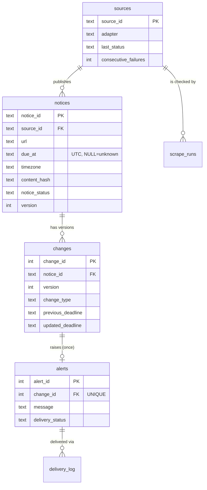

# Final Report Skeleton (Brief section 12)

Fill the bracketed parts; the technical content below is already accurate for this codebase.

1. **Cover page** - ScholarTrack: Scholarship & Fellowship Deadline Tracker; [student/team IDs]; [mentor]; [academic year].
2. **Abstract & context** - Scholarship information is scattered; students miss or misread deadlines.
   Stakeholders: students, advisors, source publishers. Success criteria: the six acceptance tests below pass; alerts are precise; stale data is always labelled.
3. **Source selection** - see `docs/SOURCE_APPROVAL.md` (permission, robots, terms, URLs, crawl policy).
4. **SRS** - Use cases: *Search & filter notices*, *View deadline timeline*, *Read alerts*, *Verify at source*, *Operator reviews failed scrapes*, *Operator forces refresh*.
   Personas: Aisha (final-year undergraduate), Mr. Rao (scholarship-office advisor). Requirements: brief sections 05-07.
   Architecture: see README "How it works". ER diagram below.
5. **Implementation** - collection (`app/fetcher.py`, `app/adapters.py`), normalisation (`app/normalize.py`),
   scheduling (`app/main.py` Scheduler + manual refresh), change detection (`app/pipeline.py`).
6. **Testing** - run `python -m pytest -v`; table below. Add screenshots of the dashboard states.
7. **Evaluation** - [measure on your real sources: % of notices with correct deadline vs manual check; alert precision = true alerts / all alerts; refresh time from the Operator "runs" table]; limitations in README.
8. **Deployment** - README "Deployment and monitoring".
9. **Ethics & conclusion** - only public pages, robots/terms obeyed, no login/CAPTCHA bypass, no personal data (the system stores none), data minimisation (listing fields only), honest freshness labels, no automated eligibility decisions. Gaps/future work: detail-page fetch, RSS/API adapters, email delivery, per-user watchlists.
10. **Appendix** - source-attributed screenshots, sample records (`sqlite3 data/scholartrack.db "select * from notices"`), `git log` evidence.

## ER diagram (Mermaid)

## Mandatory acceptance tests -> evidence

| Acceptance test | Automated test |
|---|---|
| Unknown deadline never converted to a date | `test_normalize.py::test_unknown_deadline_is_never_converted_to_a_date`, `test_pipeline.py::test_unknown_deadline_stays_null` |
| A correction appears as an update, not a new notice | `test_pipeline.py::test_source_correction_is_an_update_not_a_new_notice`, `test_api.py::test_mentor_revision_creates_update_history_and_single_alert` |
| Date filters work on timezone-aware deadlines | `test_api.py::test_date_filter_is_timezone_aware` |
| Inaccessible source is flagged, not silently skipped | `test_pipeline.py::test_unreachable_source_is_flagged_and_data_kept`, `test_api.py::test_inaccessible_source_is_flagged_not_skipped` |
| Each notice links to the original announcement | `test_api.py::test_each_notice_links_to_official_announcement` |
| Alert triggers once per meaningful revision | `test_pipeline.py::test_alert_fires_once_per_meaningful_revision` |

## Mentor checkpoints -> what to show

- **CP-1** approved problem, sources, requirements - this report + SOURCE_APPROVAL.
- **CP-2** sample extraction, field dictionary, error strategy - `tests/fixtures/`, `app/adapters.py` ALIASES, fetcher error kinds.
- **CP-3** DB design, keys, repeat-run behaviour - `migrations/001_init.sql`, `test_rerun_is_idempotent`.
- **CP-4** scheduling, change history, alerts - Operator tab + Alerts tab.
- **CP-5** two browser sessions + a source update - open two windows; change a demo notice; both show "Notices were updated" within 15 s.
- **CP-6** unseen failure simulation, viva - Operator walkthrough "Simulate failures"; be ready to explain `parse_deadline` in `app/normalize.py` and the upsert SQL in `app/pipeline.py` **in your own words**.
